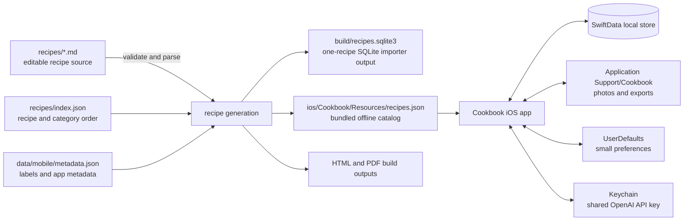
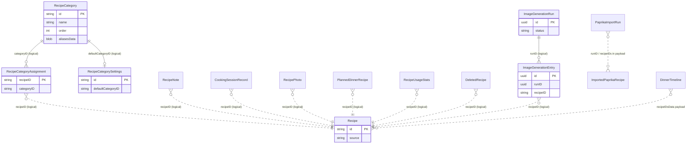
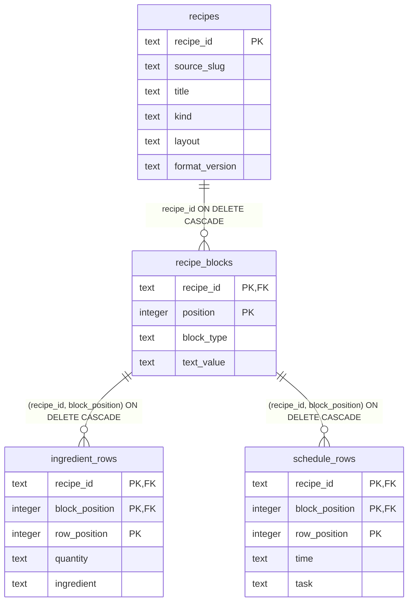

# Cookbook data model

This document describes the repository’s current data model as implemented in
the iOS app and build tools. It distinguishes the version-controlled recipe
source, generated recipe representations, and device-local user data. “Database
type” below means the logical SQLite-compatible type; SwiftData controls its
physical SQLite schema and may encode values differently.

## At a glance

The Markdown recipes are the editable source of truth. The bundled JSON catalog
is immutable app content at runtime; its decoded `Recipe` values are not rows in
SwiftData. Imported recipes and user-created state are stored locally in
SwiftData. Photo bytes, exports, and share-extension captures are files. The
SQLite schema below is generated by the standalone Markdown importer; it is not
the iOS app’s persistence schema and is currently a one-recipe-at-a-time build
artifact.

## iOS SwiftData entities

The app registers these model types in one `ModelContainer` in
`ios/Cookbook/CookbookApp.swift`. The store is local to the app and SwiftData
manages the SQLite representation. SwiftData model attributes use the following
logical type mapping in this document:

| Swift type | Logical SQLite type | Notes |
| --- | --- | --- |
| `String` | `TEXT` | IDs and serialized status values are strings unless stated otherwise. |
| `Int` | `INTEGER` | Counts and ordering values. |
| `Bool` | `INTEGER` | Logical true/false. |
| `Date` | `TIMESTAMP` | SwiftData-managed date representation; not a declared SQL column type. |
| `UUID` | `UUID` / `TEXT`-like | SwiftData-managed UUID representation; not a declared SQL column type. |
| `Data` | `BLOB` | Often contains JSON-encoded arrays, dictionaries, or Codable values. |
| `T?` | nullable `T` | Optional values may be absent. |

All `@Attribute(.unique)` properties below are unique constraints in the SwiftData
model contract. The app declares no separate `#Index` or explicit secondary
indexes. SwiftData chooses the physical indexes and SQL details; do not treat
this logical inventory as a hand-written SQL migration contract.

### Entity inventory

| Entity | Fields (`field: type`, `*` = unique) | Purpose |
| --- | --- | --- |
| `RecipeCategory` | `id*: String`, `name: String`, `order: Int`, `aliasesData: Data` | Editable categories; aliases are a JSON-encoded string array exposed as `aliases`. |
| `RecipeCategorySettings` | `id*: String`, `defaultCategoryID: String` | Singleton row conventionally keyed by `settings`; stores default category. |
| `RecipeCategoryAssignment` | `recipeID*: String`, `categoryID: String` | One current category assignment per recipe ID. |
| `ImportedPaprikaRecipe` | `id*: String`, `paprikaUID: String`, `recipeData: Data`, `importedAt: Date`, `paprikaImportRunID: String?`, `deletedAt: Date?` | Imported recipe payload and import provenance. `recipeData` decodes to a `Recipe`. |
| `ImportedWebRecipe` | `id*: String`, `recipeData: Data`, `sourceURL: String`, `capturedAt: Date`, `editedAt: Date`, `deletedAt: Date?` | Website-captured recipe payload and source/edit times. |
| `ImportedMagazineRecipe` | `id*: String`, `recipeData: Data`, `capturedAt: Date`, `deletedAt: Date?` | Recipe extracted from a magazine photo. |
| `PaprikaImportRun` | `id*: String`, `dayKey: String`, `runNumber: Int`, `labelID: String`, `createdAt: Date`, `importedRecipeIDsData: Data`, `skippedRecipesData: Data`, `importedCount: Int`, `skippedCount: Int`, `undoneAt: Date?` | Import history; ID arrays and skipped-recipe records are JSON-encoded in `Data`. |
| `DeletedRecipe` | `recipeID*: String`, `deletedAt: Date` | Soft-delete marker for a bundled or imported recipe. |
| `RecipeNote` | `id*: UUID`, `recipeID: String`, `stepID: String?`, `text: String`, `createdAt: Date`, `updatedAt: Date`, `catalogHash: String`, `deletedAt: Date?` | User notes attached to a recipe, optionally to a step; supports soft deletion and catalog-version context. |
| `CookingSessionRecord` | `recipeID*: String`, `stepID: String`, `sectionProgressData: Data`, `updatedAt: Date` | One cooking resume point per recipe; section progress is a JSON dictionary of string to string. |
| `RecipePhoto` | `id*: UUID`, `recipeID: String`, `relativePath: String`, `createdAt: Date`, `isCover: Bool` | File metadata for a recipe photo. Image bytes live in Application Support, not in this row. |
| `ImageGenerationRun` | `id*: UUID`, `createdAt: Date`, `provider: String`, `model: String`, `status: String`, `isBulk: Bool`, `recipeCount: Int`, `completedCount: Int`, `failedCount: Int` | Image generation batch or single-recipe run summary. |
| `ImageGenerationEntry` | `id*: UUID`, `runID: UUID`, `recipeID: String`, `status: String`, `generatedPhotoID: String?`, `previousPhotoID: String?`, `previousBundledAsset: String?`, `previousHadNoImage: Bool`, `errorMessage: String?` | Per-recipe work and before/after cover state for a run. |
| `DinnerTimeline` | `id*: UUID`, `name: String`, `targetDate: Date`, `recipeIDsData: Data`, `activitiesData: Data`, `updatedAt: Date` | Saved dinner schedule. Ordered recipe IDs and `TimelineActivity` values are JSON-encoded in `Data`. |
| `PlannedDinnerRecipe` | `id*: UUID`, `recipeID: String`, `dinnerDate: Date`, `addedAt: Date` | One recipe scheduled on a dinner date. No uniqueness constraint prevents scheduling the same recipe more than once. |
| `RecipeUsageStats` | `recipeID*: String`, `recipeOpenCount: Int`, `groceryAddFlowCount: Int`, `updatedAt: Date` | Aggregate open and successfully completed grocery-flow counts, one row per recipe ID. |

The catalog `Recipe` payload stored inside imported `recipeData` has `id`,
`title`, `category`, optional `collectionTitle`, `sourceFile`, `sourceSection`,
`introduction`, `ingredients`, `steps`, `tips`, `healthierOptions`, optional
`thumbnailAsset`, optional `labelIDs`, optional `provenance`, optional
`menuDescription`, optional `menuPairings`, and optional `servings`. Ingredients
and steps are nested Codable values, not independent SwiftData entities.

`RecipeIngredient` fields are `id: String`, `amount: String`, `unit: String`,
`description: String`, `groceryName: String`, `staple: Bool`,
`excludeFromGroceries: Bool`, and optional `group: String`. Its decoder also
accepts legacy `quantity`/`name` keys and normalizes them into the structured
amount/unit/description representation. `RecipeStep` fields are `id: String`,
`sectionTitle: String`, `instruction: String`, `originalInstruction: String`,
`ingredientIDs: [String]`, optional `durationMinutes: Int`, and `active: Bool`.
`RecipeProvenance` contains a source enum plus optional name and reference.

### Relationship and foreign-key map

The app currently models references as scalar IDs and Codable payloads. These
are **logical foreign keys**, not SwiftData `@Relationship` declarations, and
there is no database-enforced referential integrity or cascade behavior for
them. Code must keep references valid when records are deleted or restored.

`Recipe` in that diagram is a conceptual identity shared by the bundled catalog
and imported recipe rows. There is no central `Recipe` SwiftData table. Recipe
IDs are resolved against the bundled catalog and the three imported-recipe
entities. `ImageGenerationEntry.generatedPhotoID` and `previousPhotoID` point
to photo UUIDs serialized as strings when present; they are also application
managed references. `PaprikaImportRun.importedRecipeIDsData` stores an array of
IDs, while `ImportedPaprikaRecipe.paprikaImportRunID` stores the run ID. Dinner
recipe IDs and activities are embedded in `DinnerTimeline` JSON data. Notes'
`stepID` and recipe-step `ingredientIDs` point inside Codable recipe content,
not to separate rows.

### Uniqueness and query indexes

The following fields have declared uniqueness (`@Attribute(.unique)`):

| Entity | Unique field |
| --- | --- |
| `RecipeCategory` | `id` |
| `RecipeCategorySettings` | `id` |
| `RecipeCategoryAssignment` | `recipeID` |
| `ImportedPaprikaRecipe` | `id` |
| `ImportedWebRecipe` | `id` |
| `ImportedMagazineRecipe` | `id` |
| `PaprikaImportRun` | `id` |
| `DeletedRecipe` | `recipeID` |
| `RecipeNote` | `id` |
| `CookingSessionRecord` | `recipeID` |
| `RecipePhoto` | `id` |
| `ImageGenerationRun` | `id` |
| `ImageGenerationEntry` | `id` |
| `DinnerTimeline` | `id` |
| `PlannedDinnerRecipe` | `id` |
| `RecipeUsageStats` | `recipeID` |

There are no explicit non-unique indexes declared in the model code. Common
filters include assignment by `recipeID`, Paprika rows by `paprikaImportRunID`
and `deletedAt`, image entries by `runID` and `status`, and notes/photos/planned
dinners by `recipeID` or date. Uniqueness constraints protect the listed keys;
query performance for other properties is left to SwiftData's store and should
be revisited if data volume grows.

## Generated Markdown SQLite schema

`scripts/import_markdown_recipe_to_sqlite.py` creates/updates
`build/recipes.sqlite3` by default. It validates and replaces one recipe and its
children in a transaction. The script sets `PRAGMA foreign_keys = ON` and
`PRAGMA user_version = 1`. Types and keys are explicit here:

| Table | Columns and constraints |
| --- | --- |
| `recipes` | `recipe_id TEXT PRIMARY KEY`; `source_slug TEXT NOT NULL`; `title TEXT NOT NULL`; `kind TEXT NOT NULL CHECK kind IN ('recipe','collection')`; `layout TEXT NOT NULL`; `format_version TEXT NOT NULL`. |
| `recipe_blocks` | `recipe_id TEXT NOT NULL REFERENCES recipes(recipe_id) ON DELETE CASCADE`; `position INTEGER NOT NULL`; `block_type TEXT NOT NULL`; `text_value TEXT NULL`; `PRIMARY KEY (recipe_id, position)`. |
| `ingredient_rows` | `recipe_id TEXT NOT NULL`; `block_position INTEGER NOT NULL`; `row_position INTEGER NOT NULL`; `quantity TEXT NOT NULL`; `ingredient TEXT NOT NULL`; `PRIMARY KEY (recipe_id, block_position, row_position)`; composite FK `(recipe_id, block_position)` references `recipe_blocks(recipe_id, position) ON DELETE CASCADE`. |
| `schedule_rows` | `recipe_id TEXT NOT NULL`; `block_position INTEGER NOT NULL`; `row_position INTEGER NOT NULL`; `time TEXT NOT NULL`; `task TEXT NOT NULL`; `PRIMARY KEY (recipe_id, block_position, row_position)`; composite FK `(recipe_id, block_position)` references `recipe_blocks(recipe_id, position) ON DELETE CASCADE`. |

The primary keys are the only explicit indexes in this schema; SQLite creates
index structures to enforce them. There are no additional `CREATE INDEX`
statements. The child table keys also preserve row ordering within a recipe
block. Replacing a recipe first deletes its `recipes` row, cascading through its
blocks and ingredient/schedule rows, and then inserts the validated replacement.

## Other storage

- **Bundled catalog:** `ios/Cookbook/Resources/recipes.json` is generated from
  Markdown, ordering, and mobile metadata. `CookbookCatalog` decodes its schema
  version, category order, recipes, label groups, and labels. It is read-only
  runtime content, not the personal-data database.
- **Files:** Recipe photos are stored under the app's
  `Application Support/Cookbook` directory. `RecipePhoto.relativePath` names
  the file. Notes and usage exports, generated PDFs, and other import/export
  artifacts also use files there. Export files are snapshots, not live tables.
- **Preferences:** Small settings use `UserDefaults` / `@AppStorage`, including
  reminder list selection and AI provider/model choices. Preference values are
  not relational records.
- **Secrets:** The shared OpenAI API key is stored as a Keychain generic
  password item, under the app's service and `api-key` account; it is not in
  SwiftData or preferences.
- **Share extension:** Captured recipe payloads are staged as files for the app
  to process. They become an `ImportedWebRecipe` only after the app's extraction
  and save flow succeeds.

## Source locations and maintenance

- SwiftData entities and file paths: `ios/Cookbook/PersonalData.swift`.
- Model registration: `ios/Cookbook/CookbookApp.swift`.
- Catalog Codable types: `ios/Cookbook/Catalog.swift`.
- Generated SQLite schema: `scripts/import_markdown_recipe_to_sqlite.py`.
- Recipe source and generation architecture: [architecture.md](architecture.md)
  and [recipe-markdown-format.md](recipe-markdown-format.md).

When adding a stored property or entity, update this inventory and relationship
diagram. When introducing actual SwiftData relationships, explicit indexes, or
an incompatible stored-field change, revise the relationship and migration
notes to match the shipped model.
